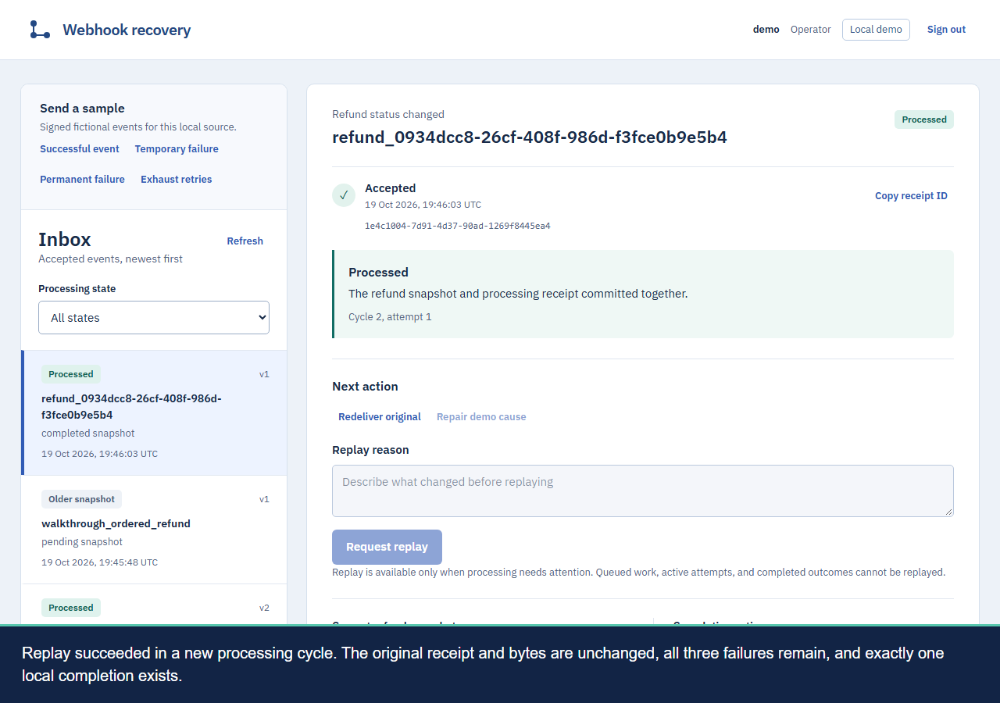

# Webhook recovery

A local webhook inbox for investigating failed processing and recovering it
without losing the original event. Send a signed fictional refund update, inspect
its durable acceptance receipt, follow each processing attempt, and replay a failed
cycle with an audited reason.

This is an engineering lab for developers evaluating durable receivers. A `202`
response proves acceptance. The console shows whether processing later succeeded,
scheduled a retry, ignored an older snapshot, or needs operator attention.



## Try it locally

Use Node 24.20.0, pnpm 11.23.0, and Docker Engine with Compose. On Windows, Docker
runs through WSL Ubuntu while Node and dependencies stay on Windows. The
[setup guide](docs/setup.md) covers readiness, credentials, ports, and shutdown.

```powershell
pnpm install --frozen-lockfile
pnpm browser:install
pnpm env:check
pnpm check
pnpm verify
```

Verification provisions a disposable PostgreSQL database, migrates and seeds it,
starts the real API, worker, and console, then exercises HTTP, database, crash,
and browser scenarios. It removes its services, volume, browser profile, and
private credentials afterward. Linux hosts may need
`pnpm browser:install --with-deps`.

For an interactive session, run `pnpm dev` and open http://127.0.0.1:4330.
Sign in with the generated `OPERATOR_TOKEN` in `.local/runs/dev/app.env`.
Send an **Exhaust retries** sample, inspect its three failed attempts, repair the
demo cause, and request replay with a reason. The recovered event keeps its original
receipt and failures. A viewer credential provides read-only inspection.

Ctrl+C or `pnpm dev:down` stops development services and preserves the developer
database. `pnpm env:status` reports owned processes and disk usage.
`pnpm cleanup --run <run-id>` recovers an interrupted disposable run and is
safe to repeat. Normal development reuses one dependency tree and image cache;
scratch reports have a five-report, 100 MiB limit.

## What it proves

Signed intake deduplicates by source and event ID. Workers claim with expiring
leases and fence late owners. A single PostgreSQL transaction applies a versioned
refund snapshot, its processing receipt, completion ledger, and final attempt
outcome. Older snapshots remain visible without overwriting newer state.

The [case study](docs/case-study.md) explains those boundaries and includes
architecture diagrams. The [scenario guide](docs/scenarios.md) documents actual
before/after-commit worker termination and resumed-owner fencing. The
[recovery runbook](docs/recovery.md) explains retries and audited replay.

The [recorded walkthroughs](docs/walkthrough.md) include English captions,
screenshots, and raw crash proof. The [fresh-checkout rehearsal](docs/rehearsal.md)
records working commands and matching before/after resource inventories.
[Delivery history](DELIVERY.md) links the merged implementation PRs and checks.

## Measurements and limits

One finite local workload accepted 600 deliveries for 500 unique events with zero
failures or timeouts. Acceptance p95 was 19.12 ms; draining all processing took
8.91 seconds from first dispatch. See the [protocol and raw results](docs/measurements.md)
for the exact revision, hardware, concurrency, timing definitions, and invariants.
These measurements do not establish production capacity or availability.

The implementation uses strict TypeScript, Fastify, Drizzle/PostgreSQL, and
React/Vite/Tailwind/TanStack Query. All business effects are synthetic and local
to one database. External payments or network effects need a separate idempotency
protocol. The finite lab retains deduplication identities without expiry.

No provider account, customer traffic, public endpoint, or hosting is required.
[Webhook Redrive](https://github.com/KleitonBarone/webhook-redrive) is the separate
outbound sender; integrating it is optional. This repository runs independently.
