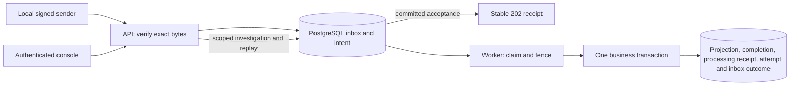
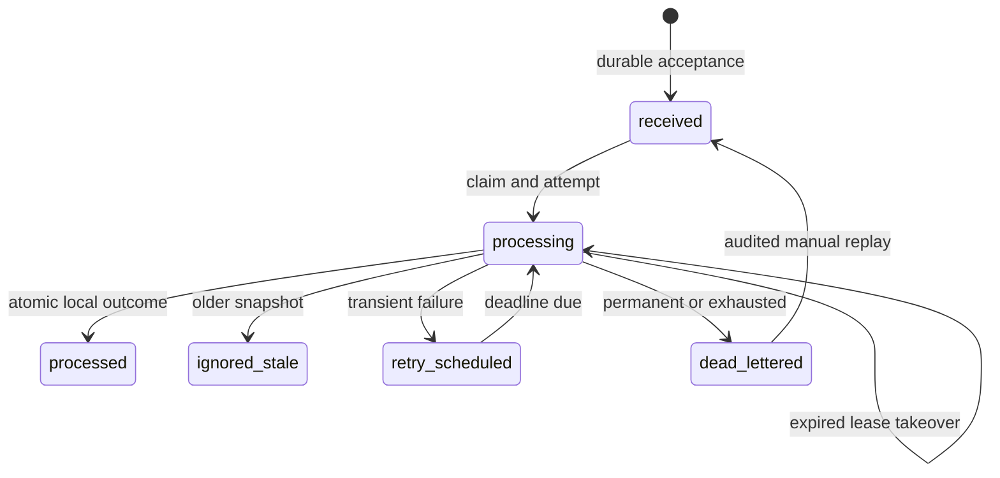

# Keeping acceptance and processing separate

Webhook recovery is a local engineering lab for incoming events. Its synthetic
refund handler makes failure and recovery observable without a payment provider
or customer data. The [recorded workload](measurements.md) and [crash scenarios](scenarios.md)
identify the tested implementation and its limits.

## The failure boundary

A sender needs a durable answer even when business processing is slow or broken.
The API verifies an HMAC over the timestamp and exact request bytes, validates a
bounded full snapshot, and inserts it into PostgreSQL. The inbox row also contains
the initial processing intent. Only after that statement commits does the API
return its 202 acceptance receipt.

The receipt describes acceptance. A processed outcome requires a later business
transaction. Losing an HTTP response or restarting the API does not change the
source/event identity. Identical bytes return the original receipt; different
bytes under that identity produce a conflict. Comparing both the body hash and
original text preserves this distinction, including JSON whitespace.

## Two kinds of duplication

Delivery identity is `(source, eventId)`. A unique constraint makes concurrent
retries converge on one accepted record. Business identity is
`(source, refundId, completion action)`. Another event can describe the same refund
completion, so a second unique constraint protects that local action independently
of transport deduplication.

Snapshots carry a positive version. A higher version replaces the projection; an
older one records a stale decision. Equal versions with matching business content
are no-ops, while contradictory equal versions become terminal conflicts. An
aggregate advisory lock serializes competing first inserts and updates. Every
data query still checks the full source/refund identity; a lock-hash collision
can add contention but cannot mix aggregates.

The permitted statuses are pending, completed, and failed. A newer snapshot may
change status after completion. The completion ledger remains historical and
records its action once. This is the lab's explicit full-snapshot contract, not a
claim about arbitrary payment-provider ordering.

## Claims and the business transaction

Workers claim received, due, or expired work using `FOR UPDATE SKIP LOCKED` in a
short transaction. The claim creates an attempt and a lease token together.
Expired running attempts become abandoned history. Claims, including abandoned
ones, consume a bounded budget within a processing cycle.

The handler's transaction locks the owned inbox row, checks the token and database
deadline, and applies the version decision. Projection, unique completion,
processing receipt, finished attempt, and inbox outcome commit together. A final
token/deadline condition fences the write after handler work. A stale process
cannot overwrite a replacement worker's outcome.

Three process experiments test different boundaries. Killing a worker before its
business commit leaves no visible effect, then lease recovery produces one
completion. Killing it after commit preserves the successful outcome and creates
no repeated attempt or completion. Pausing an owner outside its business
transaction allows a replacement to take over; resuming the old process returns
`lost_lease`. These use actual owned processes and explicit barriers. Handler
exceptions and controlled clock/metadata checks are reported separately.

## Recovery preserves evidence

Transient failures persist an exponentially delayed retry with bounded jitter.
Permanent failures and exhausted cycles become terminal. A database error rolls
back business work and leaves the lease for recovery instead of fabricating a
successful or failed-attempt commit.

An authenticated operator repairs the separate synthetic cause, then requests
replay with a reason. Replay atomically inserts an audit record and queues a fresh
cycle with its own automatic budget. Earlier attempts, raw bytes, acceptance,
versions, and business identities remain intact. A source/operator-scoped
idempotency key returns the earlier replay receipt after an uncertain response;
changed content under that key conflicts. Inbox locking and a unique key handle
both same-event and cross-event races.

The browser verifies the operator's complete recovery story, while PostgreSQL
tests prove races, rollback, ordering, and fencing. Viewers can inspect their
source but cannot mutate it. The console exchanges a local credential for an
HttpOnly session cookie and stores no token in browser storage. The server
enforces source scope, role, expiry, and matching local Origin for mutations.

## Evidence and operations

`pnpm verify` provisions its own stack and exercises HTTP, PostgreSQL, real worker
restarts/terminations, and one Chromium journey. `pnpm measure` uses a separate
fresh stack and default worker settings. Its 600 deliveries produced 500 accepted
identities and 500 local completions with all invariants passing. Median validated
receipt latency was 11.95 ms and processing was observed complete after 8.91 seconds.
Those observations describe one finite local run, not production capacity.

[Structured logs and fixed counters](observability.md) distinguish a duplicate
delivery from another processing attempt. Counters reset with their process and
can miss a post-commit log when a worker dies. Database receipts and history are
the durable evidence. Logs omit credentials, payloads, URL query values, and replay
reasons; tests check synthetic private markers.

The [environment lifecycle](setup.md) records exact resources and process markers,
owns a Windows-to-WSL session, bounds logs/reports, and removes disposable services,
volumes, browser profiles, and credentials. Repeated success, injected failure,
interruption, actual coordinator termination, and repeated cleanup were exercised.
Retained developer data and pre-existing Docker resources stay outside disposable
cleanup. A Windows reader-lock test checks manifest replacement when another
process briefly holds the file open.

## Limits

The local effect and receipt share one PostgreSQL transaction. An external refund
API would need its own idempotency and delivery protocol, such as an outbox plus a
provider idempotency key. This implementation does not promise exactly-once network
delivery or arbitrary external effects.

The finite lab retains inbox deduplication keys, attempts, replay audits, and the
completion ledger without automatic expiry. Disposable reset intentionally removes
an entire owned test environment; normal development shutdown preserves history.
A future retention policy must define the replay lifetime and deduplication window
before deleting those records.

The application is a loopback demo with synthetic snapshots and local credentials.
It does not implement production hosting, high availability, provider adapters,
external payments, enterprise tenancy, or a production retention policy. The
console's repair action clears a synthetic fault; it cannot rewrite an accepted
payload or override the version policy.
