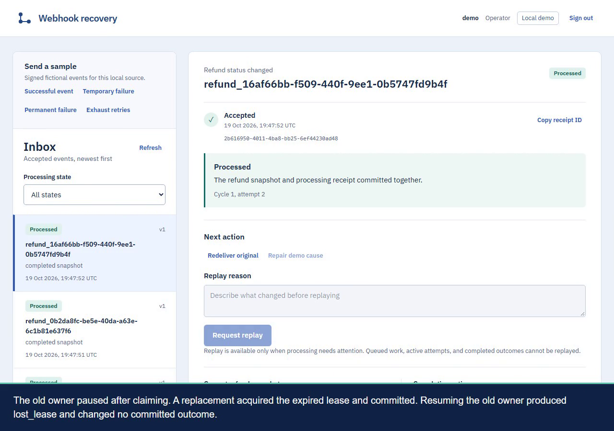

# Recorded recovery walkthroughs

These are actual local console recordings from
`bebc97eed1730ef01320058b8c38614b6186e691`, made on 2026-10-19 with fictional
events and PostgreSQL in WSL. English explanatory captions are burned into the
video. The recordings are silent. There is no human voice or impersonation.

Download the [public recordings and captions](https://github.com/KleitonBarone/webhook-recovery/releases/tag/walkthrough-2026-10-19).
The video files are hosted as release assets outside Git history:

| Recording | Video | Accompanying text |
| --- | --- | --- |
| Recovery overview, 82 seconds | [overview.mp4](https://github.com/KleitonBarone/webhook-recovery/releases/download/walkthrough-2026-10-19/overview.mp4) | [Transcript](evidence/overview.md), [SRT](evidence/overview.srt) |
| Engineering and worker termination, 172 seconds | [engineering.mp4](https://github.com/KleitonBarone/webhook-recovery/releases/download/walkthrough-2026-10-19/engineering.mp4) | [Transcript](evidence/engineering.md), [SRT](evidence/engineering.srt) |

[Artifact checksums and media metadata](evidence/walkthrough-artifacts.json)
identify the exact files, dimensions, codec, duration, source revision, and
recording script. Published MP4s have the same checksums as the originals.
Later maintenance on main fixes credential changes, partial startup cleanup,
log rotation, and repair feedback. These recordings demonstrate the pinned
revision above; the signed intake and recovery transaction boundaries remain
the same.

## Recovery overview

The short recording sends a signed event, redelivers it three times, and asserts
the original receipt, one attempt, and one completion. It then delivers version 2
before version 1 and shows that the newer completed refund remains unchanged.

The operator exhausts a sample's three automatic attempts, repairs the fictional
handler, and requests replay with a reason. The assertions check that the original
bytes, hash, receipt, and acceptance timestamp remain unchanged. The three failed
attempts remain beside the successful fourth attempt, one replay audit, and one
completion.

## Actual worker termination

The engineering recording explains the database transaction boundary and runs
the repository's real crash verifier while the console is recording. It stops
the normal worker, launches explicitly owned workers, observes IPC barriers,
and kills the actual processes before and after commit. It also pauses an old
owner, lets a replacement take over its expired lease, and resumes the old owner.
The old owner's log must report `lost_lease` without changing the committed result.

The crash demonstration uses two-second leases and eight-second barrier deadlines.
Normal workers use thirty-second leases. Barriers and database assertions choose
termination points; presentation pauses only control caption reading time.

[Raw walkthrough proof](evidence/walkthrough-proof.json) includes receipts,
worker PIDs, kill timestamps, barrier observations, before/after database counts,
attempt histories, and chapter timings. Before-commit termination leaves no
committed local effects, then recovery produces one completion. After-commit
termination preserves the first committed attempt and completion. A fresh probe
proves that the replacement worker was active.

The captions are an explanatory overlay added by the recording script; the
console data and actions are the application itself. Authentication occurs before
video capture, so no credential entry is recorded. No customer data, provider
account, or payment API is involved. The guarantee covers one local database;
external effects require a separate idempotency design.

Repeat the correctness proof with `pnpm verify`. Repeat the operator story using
the controls described in [setup](setup.md).
